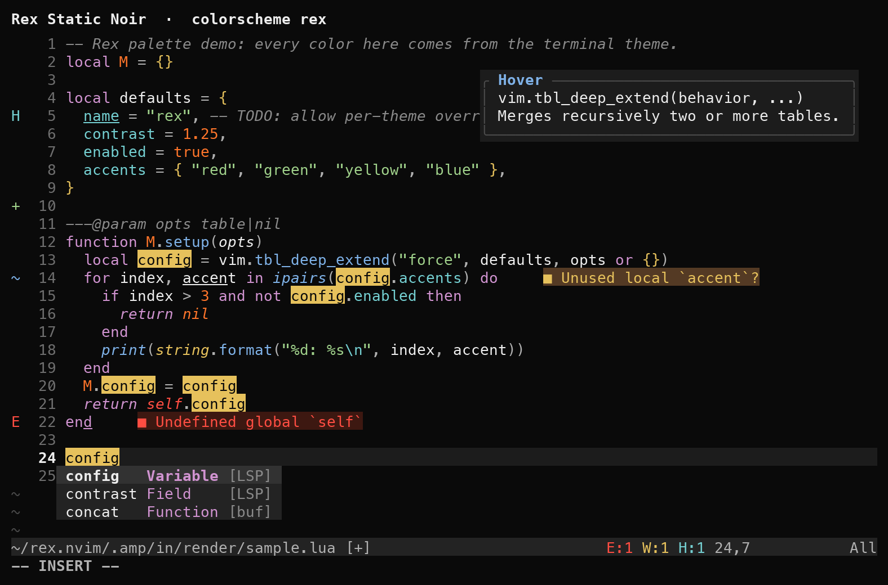
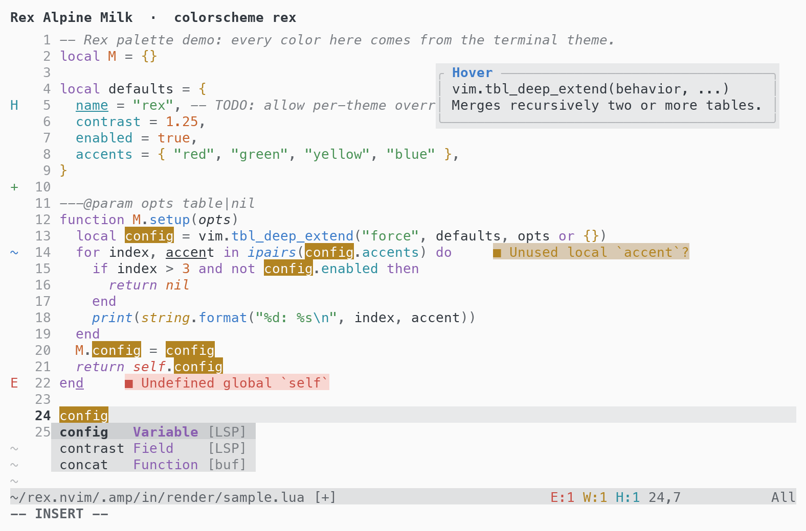
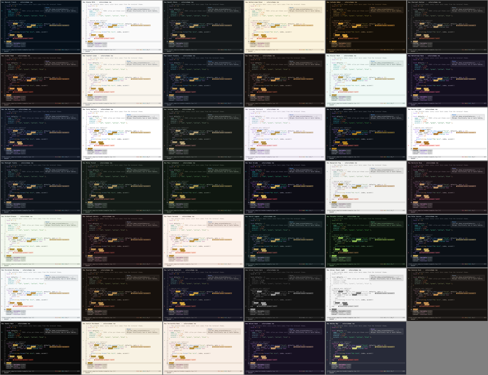

# rex.nvim

A Neovim colorscheme for the Rex terminal by Superlogical that follows whichever Rex theme is active, dark or light.

rex.nvim contains no hex colors. Every highlight is a terminal palette index, and Rex ships a full 256-color palette for each of its themes:

| Indices | In every Rex theme |
| --- | --- |
| 1–6 | the theme's red, green, yellow, blue, magenta, and cyan |
| 16, 231 | the theme's background and foreground |
| 232–255 | a ramp from background to foreground, used for UI surfaces, line numbers, and comments |
| 16–231 cube | colors tinted toward the background, used for diff and diagnostic backgrounds and orange |

So one colorscheme matches all 41 Rex themes, and it changes with the theme when you switch themes in Rex, without restarting Neovim.




<details>
<summary>All 41 Rex themes</summary>



</details>

## Install

With [lazy.nvim](https://github.com/folke/lazy.nvim):

```lua
{
  "markosnarinian/rex.nvim",
  lazy = false,
  priority = 1000,
  config = function()
    vim.cmd.colorscheme("rex")
  end,
}
```

`:colorscheme rex` turns off `termguicolors`, because Neovim uses palette colors only without 24-bit color. Rex supports both, so nothing else changes.

The scheme also works in other terminals that set a full 256-color palette from their theme, such as Ghostty with the [Rex themes for Ghostty](https://github.com/markosnarinian/rex-themes-for-ghostty).

## lualine

`theme = "auto"` picks up the bundled theme, or set it explicitly:

```lua
require("lualine").setup({ options = { theme = "rex" } })
```

## Supported plugins

Tree-sitter, LSP semantic tokens, diagnostics, blink.cmp, snacks.nvim, which-key, gitsigns, diffview, fugitive, neo-tree, nvim-tree, oil, aerial, trouble, todo-comments, rainbow-delimiters, lazy.nvim, mason, grug-far, and telescope.

## Customizing

Override groups after the scheme loads:

```lua
vim.api.nvim_create_autocmd("ColorScheme", {
  pattern = "rex",
  callback = function()
    vim.api.nvim_set_hl(0, "Comment", { ctermfg = 248, italic = true })
  end,
})
```

`require("rex").palette` maps role names such as `comment`, `blue`, and `bg2` to their palette indices.

## License

MIT
